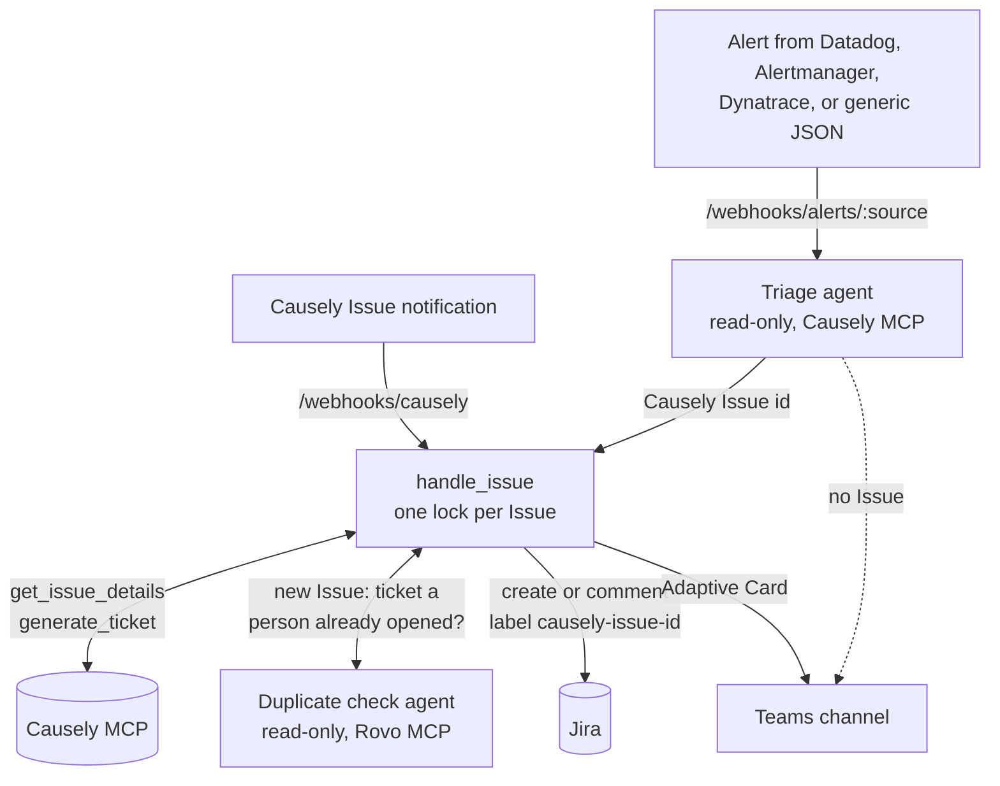

# Causely → Jira → Microsoft Teams workflow

Open one Jira ticket per [Causely](https://www.causely.ai) Issue, keep it updated with evidence, and post every step to a Microsoft Teams channel.

There are two paths to trigger this workflow:
- **A Causely Issue notification.** The Issue goes straight to ticketing.
- **An alert from another tool** (Datadog, Alertmanager, Dynatrace, or any JSON). A Claude agent uses the Causely MCP server to find the Causely Issue that explains the alert, then that Issue goes to ticketing.

Both triggers end in the same code path, ensuring there is a single Jira ticket to track the underlying cause of the issue and resolution. 

**You need:**
- A Causely account and an API client (id and secret) for the Causely MCP server
- A Jira Cloud site and an account that can create tickets in the target project
- An Anthropic API key for the Claude Agent SDK (see [Model usage and cost](#model-usage-and-cost))
- A Teams channel with a Workflows webhook
- Python 3.11+



## Try it locally with Claude Code

The quickest way to try this is to let [Claude Code](https://claude.com/claude-code) set it up for you. It starts in **dry-run mode**: Causely and Claude run for real, but nothing is written to Jira or posted to Teams. Each ticket the bot would open is saved as a Markdown file instead.

You need a Causely API client (id and secret) and an [Anthropic API key](https://console.anthropic.com/). A Claude subscription doesn't cover the agent calls. Each test alert costs a few cents. Copy this prompt into Claude Code, started in an empty folder:

<details>
<summary><b>Show the Claude Code prompt</b> (expand, then use the copy button)</summary>

````text
Help me test https://github.com/causely-oss/jira-teams-workflow locally in dry-run mode.
Go one step at a time, say briefly what each step does, and stop where I need to act.

Ground rules:
- Never print secret values or ask me to paste them into this chat. I put secrets
  into .env myself. `python -m app.cli doctor` checks they are set without showing them.
- Don't write to Jira or post to Teams unless I say yes in step 8.
- Load the env before every app command: set -a && . ./.env && set +a

1. Clone the repo into ./jira-teams-workflow and cd into it (skip if I'm already in it).
   Check that Python 3.11+ is available.
2. Create .venv, install requirements-dev.txt, and run `pytest -q`. The tests run offline and
   should all pass.
3. Run `cp .env.example .env` and `cp config.example.yaml config.yaml`. In .env, set
   JIRA_DRY_RUN=true, and set INBOUND_WEBHOOK_TOKEN to a value from
   `python -c "import secrets; print(secrets.token_urlsafe(32))"`. Write it into the file,
   don't show it. In config.yaml, set jira.projects.default to TEST and allowed to [TEST].
   This is a placeholder, because dry run writes nothing.
4. Ask me to fill in ANTHROPIC_API_KEY, CAUSELY_CLIENT_ID and CAUSELY_CLIENT_SECRET in .env.
   . Wait until I say I'm done.
5. Run `.venv/bin/python -m app.cli doctor` and help me fix every FAIL line. In dry run,
   the Jira and Teams lines may say "warn" or "dry run". That's expected.
6. Run `.venv/bin/python -m app.cli issues`. If it lists nothing, offer to set
   jira.min_ticket_severity to Low in config.yaml. Let me pick an Issue, or use the first.
7. Start the server in the background:
   `.venv/bin/uvicorn app.main:app --host 127.0.0.1 --port 8080`.
   Send every request with the header "X-Webhook-Token: $INBOUND_WEBHOOK_TOKEN".
   a. POST /replay/issue/<issue id>. Show me the JSON response, then the ticket file
      dry-run/DRYRUN-<n>.md in full.
   b. POST /replay/alert/generic with a JSON body like
      {"source":"datadog","id":"test-1","name":"<an alert name that fits the Issue>",
       "service":"<the Issue's entity name>","severity":"critical"}.
      Explain the triage verdict. If it maps to the same Issue as 7a, the result should be a
      comment on that DRYRUN ticket, not a second ticket. If it maps to a different Issue,
      explain that triage follows Causely's causal chain to the root cause.
   c. POST /replay/alert/generic for a service that doesn't exist. Expect "no_issue".
8. Summarize what happened and what it cost (the "triage done ... cost=" log lines).
   Then ask whether I want to try real Jira. If yes, stop the server and walk me through:
   - Ask whether my Atlassian org admin has allowed API tokens for the Rovo MCP server
     (admin.atlassian.com > Rovo MCP server > Authentication). This picks the setup:
     - Yes: keep jira.backend: rovo. My token must be a SCOPED token for the
       "Atlassian MCP V2" app with the scopes listed above JIRA_API_TOKEN in .env.example.
     - No or not sure: set jira.backend: rest and rovo.dedup_check: false. My token is a
       classic Jira API token (id.atlassian.com > Security > API tokens).
   - .env: I fill in JIRA_BASE_URL (https://<site>.atlassian.net), JIRA_EMAIL, and
     JIRA_API_TOKEN, then set JIRA_DRY_RUN=false.
   - config.yaml: ask for the key of a Jira project I can create issues in, ideally a test
     or sandbox project. Replace TEST with it in jira.projects.default and allowed.
   - Run doctor again. It checks that the project exists, that jira.issue_type exists
     and has no required fields the bot doesn't send (for example Components on Bug),
     and whether Rovo MCP accepts my token. Fix any FAIL line before going on. If
     issue_type fails, list the project's issue types and pick one without extra
     required fields. If priority names differ from jira.priority_map, the bot retries
     without a priority, so that's optional to fix.
   - Restart the server and replay one Issue. Show me the ticket key and its URL
     (JIRA_BASE_URL/browse/<key>). Remind me that it's a real ticket I may want to close.
   Optional: put a Teams Workflows "Send webhook alerts to a channel" URL in
   TEAMS_WORKFLOW_URL and restart.
9. When we're done, stop the server.
````

</details>

## Where Rovo sits

Rovo MCP is used in two places:

1. **Jira backend (`jira.backend: rovo`, the default in `config.example.yaml`).** Every Jira call goes through the Rovo MCP server: the label search, create, comment, and labeling. Code calls these tools directly with fixed arguments, so no model is involved. One token covers tickets and the duplicate check. The alternative, `backend: rest`, calls the Jira REST API with a classic token, but then the duplicate check can't run.
2. **Duplicate check before creating a ticket (`rovo.dedup_check`).** The label search only finds tickets this bot created. Before opening a new ticket, a read-only agent uses Rovo's `searchJiraIssuesUsingJql` and `getJiraIssue` to look for an open ticket a person already filed for the same problem. What happens next depends on its confidence:
   - **High confidence and the ticket is not Done:** the bot adds the `causely-issue-<id>` label and an evidence comment to that ticket, and creates nothing. From then on the label search finds it.
   - **Medium confidence:** the bot creates a ticket, lists the candidate as a possible duplicate, and flags it in the Teams card.
   - **Low confidence:** the bot creates a ticket, adding any related items the agent found to the description.
   - **The Rovo check fails:** the bot still creates the ticket. A Rovo outage never blocks ticketing.

   The agent only suggests a ticket. Before adding anything to it, the bot checks in Jira that the ticket is still open and in an allowed project.

Matching on text alone is not reliable. A `text ~ "payment-gw"` search also returns closed, unrelated tickets that only mention the service, which is why the agent judges each match instead of trusting it.

**Rovo Search (`use_rovo_search`, on by default).** The duplicate check also runs one Rovo Search per new ticket, which covers Confluence, so past postmortems and runbooks can appear in the ticket as related items. Each call costs up to 10 Rovo credits. It uses the Rovo and Confluence scopes on the token. Set `use_rovo_search: false` to skip it.

**Rovo MCP setup:** both uses need two things:
- An Atlassian org admin allows API tokens at admin.atlassian.com > Rovo MCP server > Authentication.
- `JIRA_API_TOKEN` is a **scoped** API token for the **Atlassian MCP V2** app, with the 8 scopes listed in `.env.example`: Jira read, write and search; Rovo and Confluence search and read; and `read:me` and `read:account`, without which every Rovo call fails with a 401. Tokens for the Jira app don't offer these scopes, and Rovo rejects classic tokens.

Without both, Rovo MCP rejects every call ("You don't have permission to connect via API token"). Use a service account API key (`ATLASSIAN_SERVICE_KEY`, Bearer auth) so tickets show the bot as their author instead of a person.

At startup the service makes one Rovo read to check access. If `backend: rovo` and Rovo is unusable, startup fails. If only the duplicate check is on, it is turned off with a warning, so it doesn't run (and cost money) without being able to search. `python -m app.cli doctor` reports the same check.

**Use case 1, Causely triggered.** Pulls the Issue from Causely MCP and searches the bot's allowed Jira projects for the label `causely-issue-<id>`. If it finds no ticket, it creates one in the project chosen as described below. If it finds one, it adds an evidence comment. Either way it posts the result to Teams.

## Choosing the Jira project

There is no implicit default project. You configure the target project, and the service enforces it at startup, when a request arrives, and before every Jira write.

```yaml
jira:
  projects:
    default: OPS                 # required
    allowed: [OPS, DEMO, DEV]    # the only projects the bot reads or writes
    blocked: [SEC, HR]
```

The project for a new ticket is chosen in this order:
1. The `?project=KEY` parameter on the webhook or replay call. It must be in `allowed`.
2. The first matching rule in `routes`, matched on cluster, namespace, entity, or team label.
3. `default`.

The guardrails:
- **At startup.** The service refuses to start if any of these is true:
  - `default` is missing or still `CHANGE_ME`
  - `default` or any route project is not allowed, or is blocked
  - an allowed project doesn't exist or the bot account can't create issues in it
- **On each request.** A `?project=` value that isn't allowed gets a 400 response.
- **At write time.** If the chosen project isn't permitted, the bot creates no ticket and posts a "refused" card to Teams.
- **What the bot can see.** Label lookups and Rovo duplicate searches are limited to `allowed` projects. The bot never comments on, labels, or adopts a ticket outside them, even if Rovo suggests one.

`GET /projects` shows the active policy. For customer setups, use one deployment per customer, or one route per cluster.

**Use case 2, alert triggered.** Normalizes the alert, then a read-only Claude agent runs the `causely-alert-triage` decision tree to find the Issue that explains it. That Issue id goes through the same `handle_issue` path, and the alert is attached as evidence. If no active Issue explains the alert, the bot posts to Teams only and does not create a ticket.

## Model usage and cost

Two steps use an LLM agent, through the [Claude Agent SDK](https://docs.claude.com/en/docs/agent-sdk/overview). Everything else, including every Jira and Teams write, is plain code.

| Step | File | Tools (read-only) | Typical cost | Cap |
|---|---|---|---|---|
| Map an alert to a Causely Issue | `app/triage_agent.py` | Causely MCP | $0.05–0.15 per alert | $0.50, 12 turns |
| Find a ticket a person already opened | `app/rovo_agent.py` | Rovo MCP (Jira search) | about $0.09 per new ticket | $0.40, 10 turns |

Only use case 2 depends on the triage agent. Set `rovo.dedup_check: false` to skip the duplicate check. Causely-triggered tickets then need no model calls, apart from `generate_ticket`, which runs inside Causely.

The SDK runs a bundled Claude Code binary as a subprocess, using `ANTHROPIC_API_KEY`. At startup it logs that claude.ai connectors are disabled. That is expected.

## Using a different agent framework

Only `app/triage_agent.py` and `app/rovo_agent.py` import the Claude Agent SDK. The workflow takes each agent as a plain async function, wired up in `app/main.py`, and the tests pass in fakes. To use another framework (OpenAI Agents SDK, LangGraph, Google ADK, or your own tool loop), rewrite those two functions and keep their contracts:

| Function | Input | Must return |
|---|---|---|
| `triage_alert` | `NormalizedAlert` | `{"mapping_state": str, "issue_id": str \| null, "summary": str, "root_entity"?, "diagnosis"?}` |
| `find_existing_ticket` | `IssueSnapshot` | `{"duplicate_key": str \| null, "confidence": "high" \| "medium" \| "low", "rationale": str, "related": [{"ref", "title", "why"}]}` |

Keep these guardrails in your version:
- **Read-only tools only.** Copy the allowlists, `READ_ONLY_TOOLS` in `triage_agent.py` and `tools` in `rovo_agent.py`, and give the agent no shell or file tools.
- **A turn and cost limit** for each run.
- **Structured output** that matches the schema. If the answer can't be parsed, return the fallback verdict (no Issue, no duplicate), never a guess.

The workflow fetches every Issue id and ticket key an agent returns again before it acts on it, so a wrong answer can't cause a wrong write.

## Setup

```bash
python -m venv .venv && . .venv/bin/activate
pip install -r requirements-dev.txt   # app + test deps (deploys use requirements.txt)
cp .env.example .env              # fill in secrets
cp config.example.yaml config.yaml  # set jira.projects (the service won't start with CHANGE_ME)
set -a && . ./.env && set +a
python -m app.cli doctor          # checks config, credentials, Causely, and the Jira issue type
python -m app.cli issues          # active Causely Issues you can replay
uvicorn app.main:app --host 0.0.0.0 --port 8080
pytest -q                         # offline; no credentials needed
```

The Agent SDK wheels for Linux, macOS, and Windows bundle their own Claude Code binary, so Node.js isn't needed.

**Dry run.** With `JIRA_DRY_RUN=true`, nothing is written to Jira. Each ticket the bot would create goes to `dry-run/DRYRUN-<n>.md`, and comments are appended to the same file. Jira credentials are optional. With credentials, the label lookups still read the real Jira, so the duplicate checks behave as they would in production. Without them, the Rovo duplicate check is skipped. Dry runs keep their own `state.dryrun.db`, so the fake keys never mix with real tickets.

### Teams (output)
In the target channel, open Workflows and create **"Send webhook alerts to a channel"** (the old name was "Post to a channel when a webhook request is received"). Put its URL in `TEAMS_WORKFLOW_URL`. That template accepts an unauthenticated POST. The "specific people" and "people in an org" templates require a signed-in caller, which this service is not.

### Causely (trigger 1)
Point Causely's Issue notifications at `https://<host>/webhooks/causely?token=<INBOUND_WEBHOOK_TOKEN>`. The parser does not assume a payload shape. It finds the Issue UUID in an `issue_id` field, an `issue.id` field, or any portal `/issues/<uuid>` link.

**If Causely can only notify Teams directly:** add a second Power Automate flow on that channel ("When a new channel message is added" → HTTP POST to `/webhooks/causely`). Two other options don't work well:
- A Teams bot cannot see messages posted by other bots or webhooks.
- Graph change notifications need protected-API approval.

### Alert sources (trigger 2)
- **Alertmanager:** add a `webhook_configs` receiver with url `https://<host>/webhooks/alerts/alertmanager?token=...`.
- **Datadog:** create a Webhook integration with this custom payload:
  `{"title":"$EVENT_TITLE","alert_id":"$ALERT_ID","alert_transition":"$ALERT_TRANSITION","priority":"$PRIORITY","tags":"$TAGS"}`
- **Dynatrace:** create a problem notification webhook with this custom payload:
  `{"PID":"{PID}","ProblemTitle":"{ProblemTitle}","State":"{State}","ProblemSeverity":"{ProblemSeverity}","ImpactedEntity":"{ImpactedEntity}","Tags":"{Tags}"}`

### Try it
Pick an active Issue in the Causely portal (severity at or above `min_ticket_severity`) and a service it affects:
```bash
curl -X POST "localhost:8080/replay/issue/<causely-issue-id>?token=$INBOUND_WEBHOOK_TOKEN"
curl -X POST "localhost:8080/webhooks/alerts/generic?token=$INBOUND_WEBHOOK_TOKEN" \
  -H 'content-type: application/json' \
  -d '{"name":"CheckoutErrorRateHigh","service":"<affected-service>","severity":"critical"}'
```
The first call creates the ticket. The second should land as evidence on the same ticket: two tools, one Issue, one ticket. Add `?project=KEY` to either call to pick an allowed project other than the default.

The `/webhooks/alerts/*` routes return `202` and work in the background. To see the triage verdict and the ticket in the response, send the same payload to `/replay/alert/{source}`:
```bash
curl -X POST "localhost:8080/replay/alert/alertmanager?token=$INBOUND_WEBHOOK_TOKEN" \
  -H 'content-type: application/json' \
  -d '{"alerts":[{"status":"firing","fingerprint":"demo-1","labels":{"alertname":"KubePodCrashLooping","namespace":"<namespace>","pod":"<pod>","container":"<container>"}}]}'
```
A repeat of the same `fingerprint` is ignored for `alerts.dedup_window_seconds` (10 minutes by default).
When an alert opens a new ticket, the ticket names the alert, and the alert is included in the `generate_ticket` task.

## Deploying

The app is a small web service that you host yourself. It needs:
- **A public HTTPS address for `/webhooks/*`.** Causely, Datadog, and Dynatrace call it from the internet. An Alertmanager in the same cluster can use the internal address.
- **Outbound access** to Causely, your Jira site, `api.anthropic.com`, and your Teams webhook.
- **Exactly one instance, always on.** The per-Issue lock and the SQLite state live in the process, so a second replica could create duplicate tickets. Don't use serverless or scale-to-zero platforms: webhooks return `202` and the work continues after the response.
- **A persistent volume for `STATE_DB`.** If it's lost, nothing breaks, but you get one re-sync comment per open ticket.

Keep `/replay/*` private. Those routes run agents on demand and are meant for testing.

### Container
CI publishes a multi-arch image (`linux/amd64`, `linux/arm64`) for every push to `main` and every `v*` tag:
```bash
docker run --env-file .env -v "$PWD/config.yaml:/config/config.yaml:ro" -v causely-jira-state:/data \
  -p 8080:8080 ghcr.io/causely-oss/jira-teams-workflow:main
```
To build it yourself, run `docker build -t jira-teams-workflow .`.
Use a Debian-based image, as the Dockerfile does. The SDK's bundled binary doesn't run on Alpine.

### Kubernetes
`deploy/kubernetes.yaml` runs one replica with the `Recreate` strategy, so pods never overlap during a rollout. It adds a 1Gi volume for state and an Ingress that exposes only `/webhooks`.
```bash
kubectl create namespace causely-jira
kubectl -n causely-jira create secret generic causely-jira-env --from-env-file=.env
kubectl -n causely-jira create configmap causely-jira-config --from-file=config.yaml
# set the Ingress host (and pin an image tag) in deploy/kubernetes.yaml, then:
kubectl apply -f deploy/kubernetes.yaml
```

Notes:
- `--from-env-file` keeps quote characters as part of the value, so a quoted `JIRA_API_TOKEN='...'` in `.env` is sent with the quotes and Rovo rejects it with a 401. Remove any quotes from `.env` before creating the secret.
- The Ingress in the manifest has no `ingressClassName`, so on a cluster without a default class it never gets an address. Set the class for your controller. On EKS with the AWS Load Balancer Controller that is `ingressClassName: alb` plus `alb.ingress.kubernetes.io/*` annotations (scheme, target type, health check path `/healthz`).
- The Service listens on port 80 and forwards to the container's 8080. To test it with `kubectl port-forward`, use `svc/causely-jira 8080:80`, not `8080:8080`.

### Other hosts
Any container platform works if you pin it to one always-on instance, keep CPU allocated between requests, and mount a volume for `/data`. Examples: ECS/Fargate, Azure Container Apps, or Cloud Run with min = max = 1 instances and "CPU always allocated". A VM running Docker or systemd behind a TLS proxy also works.

To test real webhooks from a laptop, expose port 8080 with a tunnel such as `cloudflared tunnel --url http://localhost:8080` or `ngrok http 8080`.

## Troubleshooting
- **`Causely token request failed: HTTP 401`.** `CAUSELY_TOKEN_URL` points at a different Causely environment than your client id. The MCP, token, and portal URLs must all match.
- **`Jira rejected ticket create`.** The message includes Jira's reason. The usual cause is a field the issue type requires on its create screen, for example Components. List the fields with `GET /rest/api/3/issue/createmeta/<KEY>/issuetypes/<id>`, then pick an `issue_type` without extra required fields or relax the screen. If the priority is rejected, the code retries without it.
- **Startup fails with `Jira projects not found`.** The bot account can't see or create issues in one of the `allowed` projects.

## Known limitations
- **Single process only.** For multiple replicas, replace the asyncio lock and SQLite with a Postgres advisory lock or Redis.
- **Rovo backend.** The code searches the `createJiraIssue` response for the issue key, because the response shape isn't documented. The `rest` backend doesn't have this issue.

## Ideas, not yet built
- A Bot Framework bot for threaded replies and `@bot triage <alert>` in the channel.
- Store the evidence fingerprint in a Jira issue property, so a restart doesn't cause one re-sync comment per ticket.
- A Jira transition when an Issue resolves (currently a comment only).

## License

Apache License 2.0. See [LICENSE](LICENSE).
